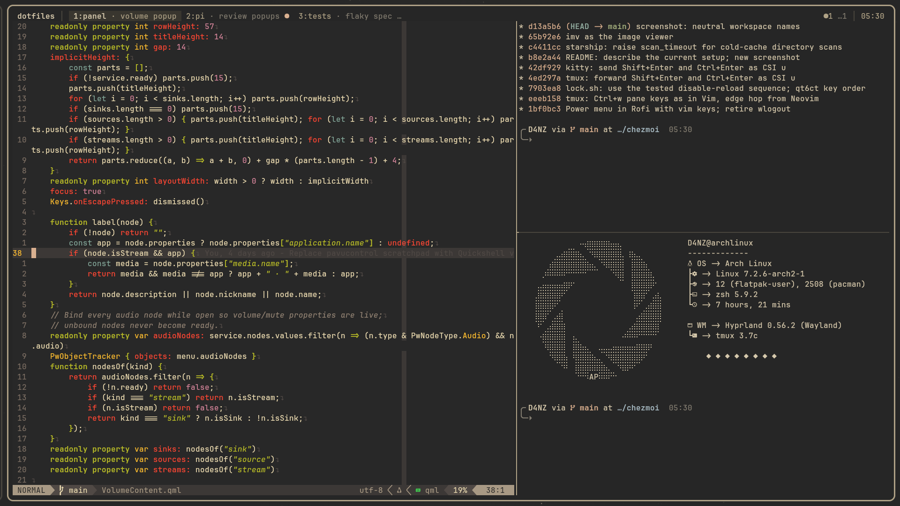

# dotfiles



Arch Linux, Hyprland, one palette everywhere: charcoal `#262626`, cream
`#d5c8ac`, accent `#d9b090`. Managed with [chezmoi](https://www.chezmoi.io).

## What is here

**Desktop**

- **Hyprland**, configured in Lua (`hypr/hyprland.lua` plus `modules/`):
  hyprsplit per-monitor workspaces, ScrollOverview, static wallpaper.
- **Quickshell** panel: an on-demand top bar with clock, network, volume and
  Bluetooth popups built on Quickshell's own bindings, no external tools
  (`quickshell/panel/README.md`).
- **Rofi** for launcher, emoji, calculator and the power menu
  (Super+Shift+P), with vim keys.
- **Dunst** notifications, **swaylock** on the wallpaper with a script that
  recovers from a monitor Hyprland reports at 0×0, **hypridle**.
- **GTK 3/4** via adw-gtk-theme and a `gtk.css` that maps Adwaita's named
  colours onto the palette; **Qt 5/6** via qt6ct/qt5ct with Fusion and a
  matching colour scheme. Icons are Tela (brown), built by
  `setup/scripts/icons.sh` into `~/.local/share/icons` so only one colour
  variant is installed.

**Terminal**

- **kitty** with the `charcoal.conf` theme; new windows attach to the last
  normal Zellij workspace.
- **Zellij** as a keyboard-first workspace manager: named project sessions,
  stable numbered task tabs, shared task notes, directory browsing with lf,
  fzf workspace/agent pickers, and exact Pi conversation restoration.
  Ctrl+Space is the prefix; g lists agents needing attention, G the fleet.
  The top bar shows the workspace name. Optional remote workspaces use SSH
  and Mosh. Details in [`dot_config/zellij/README.md`](dot_config/zellij/README.md).
- **zsh** with starship, lazy nvm, cached completions; **bat**, **lazygit**,
  **fastfetch**, **cava** on the same palette.
- **Neovim** (lazy.nvim, LSP, DAP, treesitter). A small plugin makes
  `Ctrl+w h/j/k/l` hop to the neighbouring Zellij pane at a window edge.

**Browser**

- **Zen** styling, privacy prefs and add-on policies applied by
  `zen-style/apply.py` into whichever profile exists. No profile data is
  tracked (`zen-style/README.md`).

**Pi**

- A Zellij extension (`dot_config/zellij/pi/zellij.ts`) and the
  `terminal-workspaces` skill report Pi state, preserve exact conversation
  references across reboots, and open task tabs, splits or parallel sessions
  when asked. Notifications contain task labels, not conversation text.
  Panes without a saved conversation reference restore as ordinary shells.

## Install

```bash
chezmoi init --apply D4NZ-jpg
```

`run_after_install_pkgs.sh` runs `setup/scripts/install.sh`: packages from
`setup/pkgs/pkgs.lst` (and `extras.lst`), the NVIDIA driver chosen for the
detected GPU (`nvidia.sh`), services from `system_ctl.lst`, then
`post-install.sh` (default shell, Zen, icons, Hyprland plugins). Arch only.

`run_after_zellij-plugins.sh` installs checksum-pinned autolock and builds
our workspace-labelled tab bar from pinned sources with an isolated Rust/WASI
toolchain. No compiled plugin or private workspace state is tracked.

Tmux config, helpers and its package entry have been removed. Applying these
files does not stop or uninstall an already running tmux installation.

New tools go in `setup/pkgs/pkgs.lst`; per-machine paths use chezmoi
templates (`qt6ct.conf.tmpl`), never absolute home paths.

## Tests

`tests/` holds Python and QML checks for the installer helpers, the Zen
scripts, the Quickshell popups and the Neovim DAP config. They run without
touching the live system:

```bash
python tests/installer-utils.py
python tests/quickshell-panel.py
python tests/zellij-workspaces.py
python tests/zellij-remotes.py
python tests/zellij-ssh-reuse.py
node tests/zellij-extension.mjs
lua tests/nvim-navigation.lua
```

Zellij's native tests use disposable sessions and fake Pi/transport commands.
Authenticated remote tests are opt-in; see the Zellij README for requirements.
